# WexaShelf · Self-hosted app directory

WexaShelf is an open-source, self-hosted app directory for Android, iOS, and Windows. Publish comparisons and guides on your own domain with listings that link to the Google Play Store, Apple App Store, and Microsoft Store.

Readers install apps through their official store pages. The catalog can also include alternatives, editorial lists, and articles, with source references alongside the content.

[Install](#install) · [Browse all 16 themes](#themes) · [Contributing](#contributing)

## Preview

[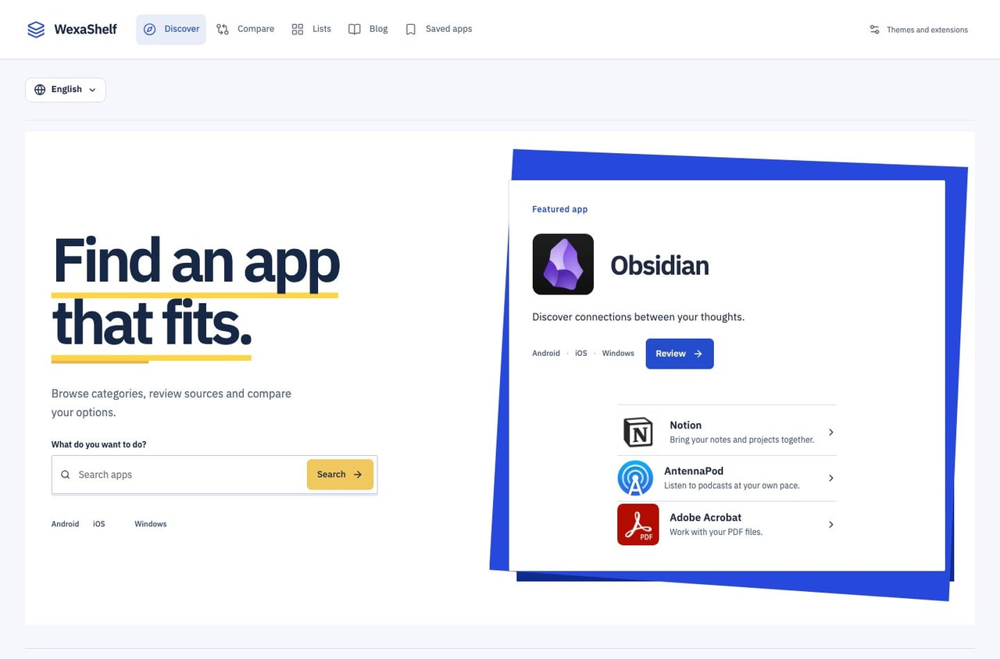](docs/screenshots/kobalt-atlas/home.jpg)

**Kobalt Atlas** running the bundled sample catalog. Open the image for the full homepage. The gallery shows the current development build.

[Filtered catalog](docs/screenshots/journeys/filtered.jpg) · [App details](docs/screenshots/journeys/detail.jpg) · [Comparison](docs/screenshots/journeys/compare.jpg) · [Collection](docs/screenshots/journeys/collection.jpg)

## What it includes

- Catalog search, platform and category browsing, comparisons, saved apps and personal collections.
- Editorial pages for app guides, comparisons, alternatives, authors and test-lab notes.
- Source references, dated observations, revision history and a review workflow for translations and content changes.
- English by default, Turkish support and community language packs. Each language has its own URLs and SEO metadata, while record IDs and source facts stay consistent.
- Sixteen built-in themes with real browser-captured previews, configurable appearance and separate site identity. [Browse the theme guide](docs/THEME-COLLECTION.md).
- Owner, editor, publisher and analyst roles, with guarded saves, revision checks, backups and upgrade tools.
- An optional AI content helper for draft titles, descriptions and related editorial work; generated text remains a draft for human review.
- Optional app submissions, disabled by default. Owners can receive official store links and images, review them, and create an unpublished catalog draft. [Read the submissions workflow](docs/APP-SUBMISSIONS.md).

## Runtime and hosting

The primary application runs on PHP 8.3+ with MySQL or MariaDB. It is designed for compatible shared hosting and cPanel installations, with Docker also included. Node.js and npm are development/build tools; the PHP hosting package does not require Node.js on the server.

The public site uses localized routes and keeps legacy Turkish paths working. The administration panel is available at `/admin`, and the installer starts at `/install`.

## Install

For a hosting installation, create an empty MySQL database and user, select PHP 8.3+ with `pdo_mysql`, `curl`, `mbstring`, `intl`, `session` and `fileinfo`, upload the PHP package, and open `/install`. Choose an empty or sample catalog, set a unique owner password, then review the owner health panel before enabling indexing.

- [cPanel installation](docs/KURULUM_CPANEL.md)
- [Installation and owner operations](docs/INSTALL-OPERATIONS.md)
- [Local development and Docker](docs/YEREL_DAGITIM.md)
- [Upgrade and recovery](docs/UPGRADING.md)

For Docker, copy `.env.example` to a private `.env`, replace every required secret, and run:

```sh
docker compose up -d --build
```

Keep `storage/config.php`, installation keys, provider settings, backups, logs and database files private. Do not overwrite private storage during an upgrade.

## Themes

Select a theme to open its full homepage. All sixteen use the same sample catalog.

<table>
<tr>
<td><a href="docs/screenshots/kobalt-atlas/home.jpg">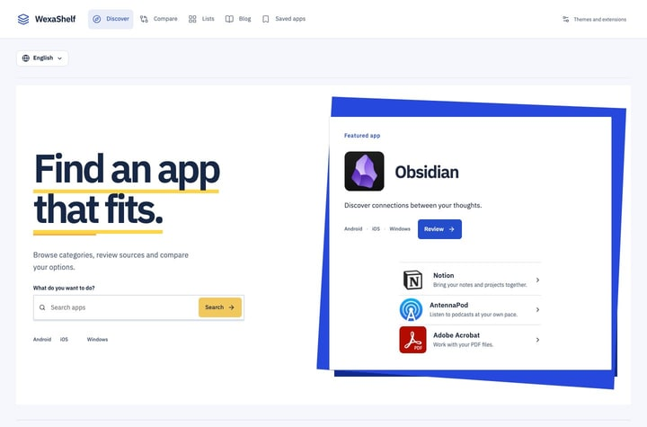</a><br><strong>Kobalt Atlas</strong><br>Blue, search-led atlas with category and editorial panels.<br><a href="docs/screenshots/kobalt-atlas/mobile.jpg">Mobile preview</a></td>
<td><a href="docs/screenshots/canli-katalog/home.jpg">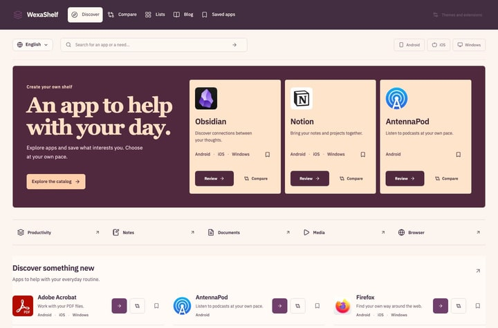</a><br><strong>Canlı Katalog</strong><br>Warm catalog layout with a featured selection and app cards.<br><a href="docs/screenshots/canli-katalog/mobile.jpg">Mobile preview</a></td>
</tr>
<tr>
<td><a href="docs/screenshots/gece-rotalari/home.jpg">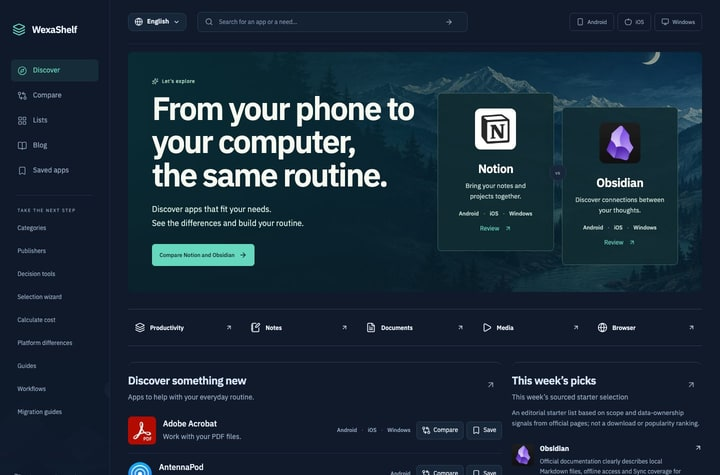</a><br><strong>Gece Rotaları</strong><br>Dark route-style layout with a focused comparison hero.<br><a href="docs/screenshots/gece-rotalari/mobile.jpg">Mobile preview</a></td>
<td><a href="docs/screenshots/is-akisi-haritasi/home.jpg">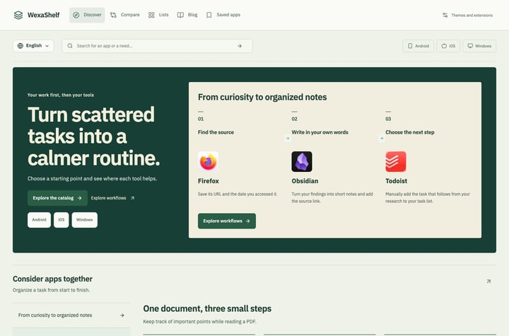</a><br><strong>İş Akışı Haritası</strong><br>Top-nav workflow layout organized around practical steps.<br><a href="docs/screenshots/is-akisi-haritasi/mobile.jpg">Mobile preview</a></td>
</tr>
<tr>
<td><a href="docs/screenshots/velvet/home.jpg">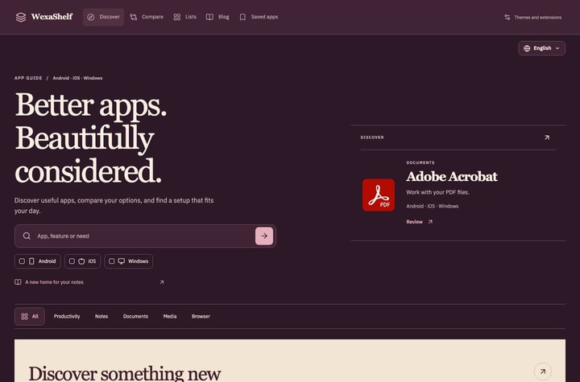</a><br><strong>Velvet</strong><br>Dark cherry palette with expressive serif editorial headings.<br><a href="docs/screenshots/velvet/mobile.jpg">Mobile preview</a></td>
<td><a href="docs/screenshots/copper-desk/home.jpg">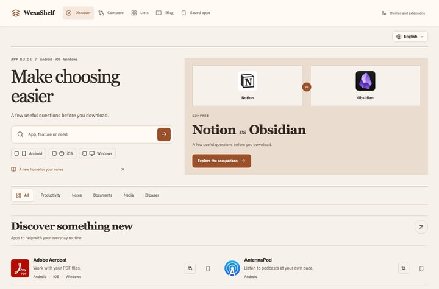</a><br><strong>Copper Desk</strong><br>Warm comparison-led opening with an editorial desk feel.<br><a href="docs/screenshots/copper-desk/mobile.jpg">Mobile preview</a></td>
</tr>
<tr>
<td><a href="docs/screenshots/porcelain/home.jpg">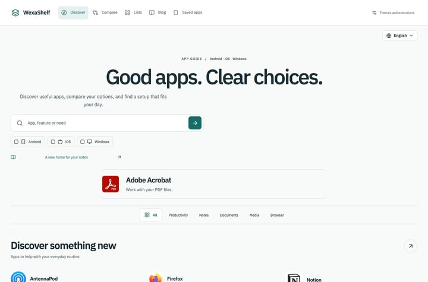</a><br><strong>Porcelain</strong><br>Centered search and teal comparison feature.<br><a href="docs/screenshots/porcelain/mobile.jpg">Mobile preview</a></td>
<td><a href="docs/screenshots/tide/home.jpg">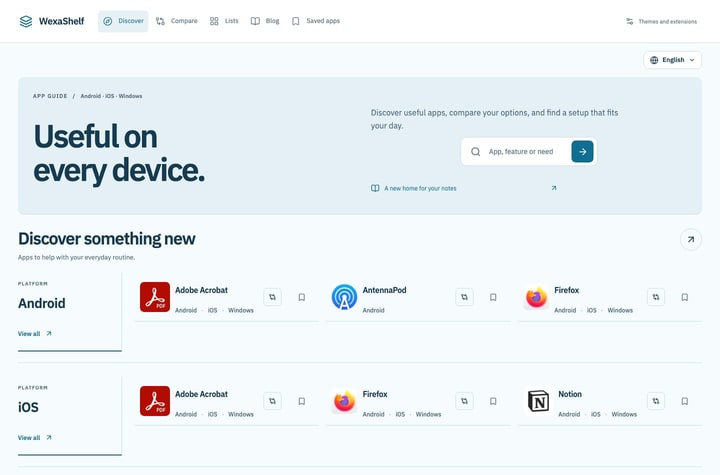</a><br><strong>Tide</strong><br>Coastal blue layout with platform-based app shelves.<br><a href="docs/screenshots/tide/mobile.jpg">Mobile preview</a></td>
</tr>
<tr>
<td><a href="docs/screenshots/index/home.jpg">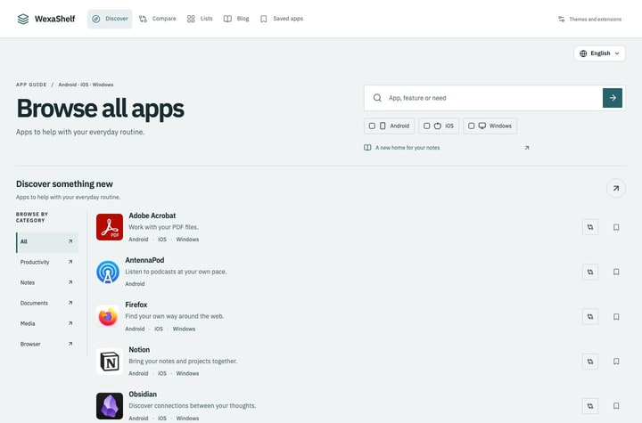</a><br><strong>Index</strong><br>Compact browsing with application rows and contextual reading.<br><a href="docs/screenshots/index/mobile.jpg">Mobile preview</a></td>
<td><a href="docs/screenshots/prism/home.jpg">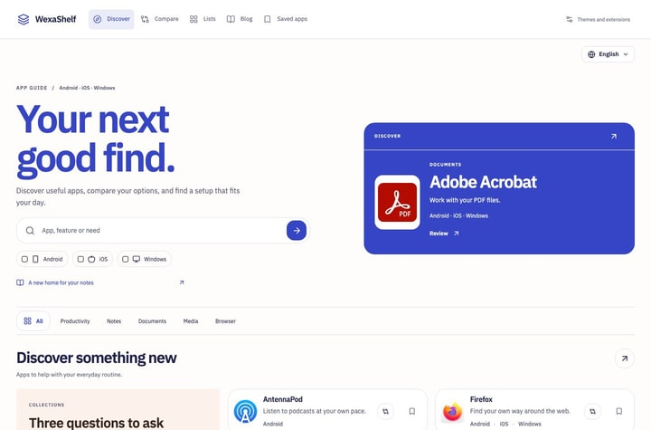</a><br><strong>Prism</strong><br>Coral and blue palette with varied editorial card sizes.<br><a href="docs/screenshots/prism/mobile.jpg">Mobile preview</a></td>
</tr>
<tr>
<td><a href="docs/screenshots/ember/home.jpg">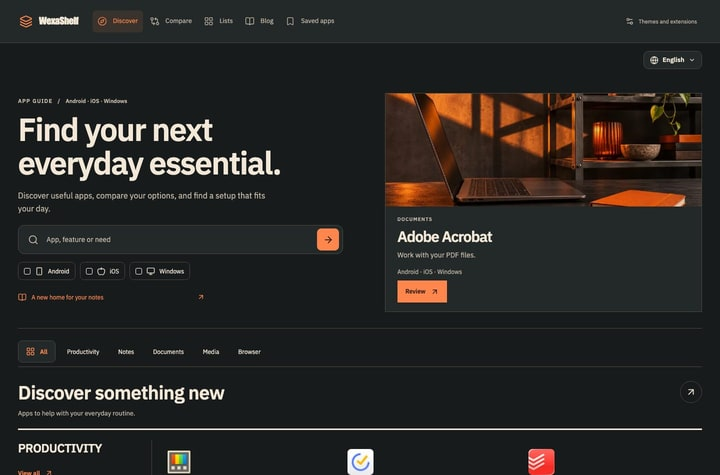</a><br><strong>Ember</strong><br>Charcoal and orange with strong editorial contrast.<br><a href="docs/screenshots/ember/mobile.jpg">Mobile preview</a></td>
<td><a href="docs/screenshots/signal/home.jpg">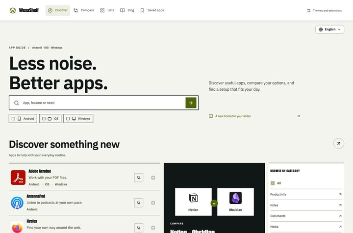</a><br><strong>Signal</strong><br>High contrast, lime accents and a geometric shortlist.<br><a href="docs/screenshots/signal/mobile.jpg">Mobile preview</a></td>
</tr>
<tr>
<td><a href="docs/screenshots/lilac-studio/home.jpg">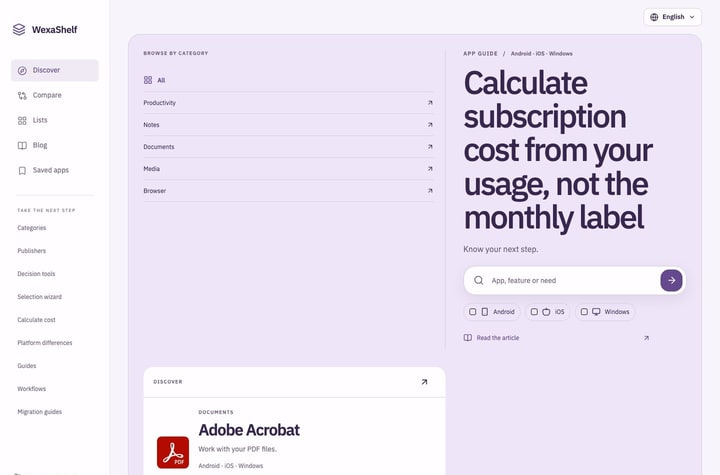</a><br><strong>Lilac Studio</strong><br>Soft violet discovery gallery with an editorial rail.<br><a href="docs/screenshots/lilac-studio/mobile.jpg">Mobile preview</a></td>
<td><a href="docs/screenshots/fieldnotes/home.jpg">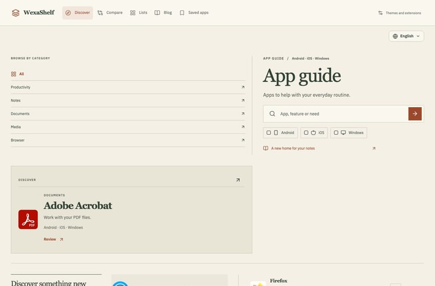</a><br><strong>Fieldnotes</strong><br>Warm paper tones, serif headings and an editorial index.<br><a href="docs/screenshots/fieldnotes/mobile.jpg">Mobile preview</a></td>
</tr>
<tr>
<td><a href="docs/screenshots/editorial-desk/home.jpg">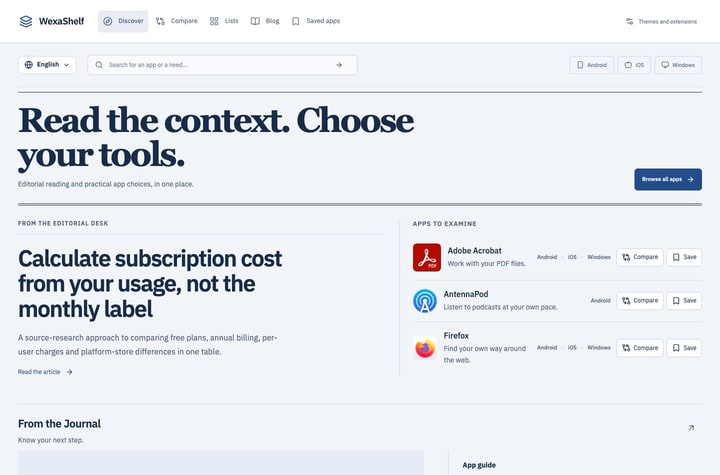</a><br><strong>Editorial Desk</strong><br>Magazine-style layout for guides, comparisons and reading lists.<br><a href="docs/screenshots/editorial-desk/mobile.jpg">Mobile preview</a></td>
<td><a href="docs/screenshots/compact-directory/home.jpg">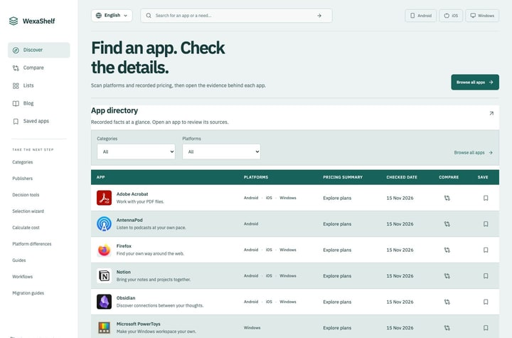</a><br><strong>Compact Directory</strong><br>Dense directory view for quick scanning and filtering.<br><a href="docs/screenshots/compact-directory/mobile.jpg">Mobile preview</a></td>
</tr>
</table>

[Theme settings and customization](docs/THEME-COLLECTION.md)

## Develop

Development requires Node.js 24+, npm, PHP and a MySQL/MariaDB fixture. Use isolated synthetic data for tests and local browser checks.

```sh
npm ci
npm run typecheck
npm test
node scripts/check-locales.mjs
npm run build:php
npm run dev
```

The primary PHP development server listens on `http://127.0.0.1:3141`. `npm run dev:legacy` starts the retained Next.js reference line on port 3140; it is not the primary runtime.

For packaging and the relevant release checks:

```sh
npm run package:php
npm run package:source
node scripts/test-release-package.mjs
```

Read [TESTING.md](documents/TESTING.md) before running browser, installer or database checks. Detailed validation, performance observations and historical release measurements belong in the linked reports, not in the product summary: [0.8 validation](docs/RELEASE-0.8.0-VALIDATION.md), [performance report](docs/PERFORMANCE-AUDIT-REPORT.md) and [distribution acceptance](docs/DISTRIBUTION-ACCEPTANCE.md). Older 0.8 archives do not contain every addition in the current source tree.

## Contributing

Start with [AGENTS.md](AGENTS.md), [CONTRIBUTING.md](CONTRIBUTING.md), the [contributor handbook](documents/README.md) and the [AI contribution workflow](documents/AI-CONTRIBUTION.md). Human and AI-assisted contributors should keep changes focused, use synthetic fixtures, preserve language and source-data boundaries, and report the commands actually run. An assistant must prepare the reviewed local diff and PR text, verify the real repository, account, fork and base branch, and ask the computer owner for explicit consent before committing, pushing or opening a PR unless that exact publication scope is already authorized.

## License

Developed by [Softwexa](https://softwexa.com). WexaShelf uses the [MIT license](LICENSE). Third-party libraries, application icons, names and trademarks retain their own terms; see [THIRD_PARTY_NOTICES.md](THIRD_PARTY_NOTICES.md).
