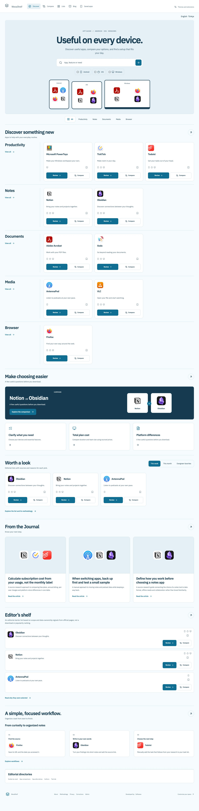

# Tide

An open blue cross-device guide with category-led app rows and a clear comparison section.

This portable configuration requires the WexaShelf build containing the sixteen-template theme collection. Older builds without this template will reject it.

Import theme.json in Admin > Appearance, customize and preview, then explicitly activate. screen.jpg is a real browser capture of the implemented homepage with a synthetic catalog, not an image-generation concept. Your own content, language and branding may differ.

Colors, navigation, density, heading typography, width, corners, hero spacing, cards and homepage section order/visibility are configurable. The owner manages the site name and logo separately; importing a theme cannot replace them.

Configuration/code: MIT, Copyright 2026 Softwexa. Third-party application names/icons remain the property of their owners. See the main distribution THIRD_PARTY_NOTICES.md.

